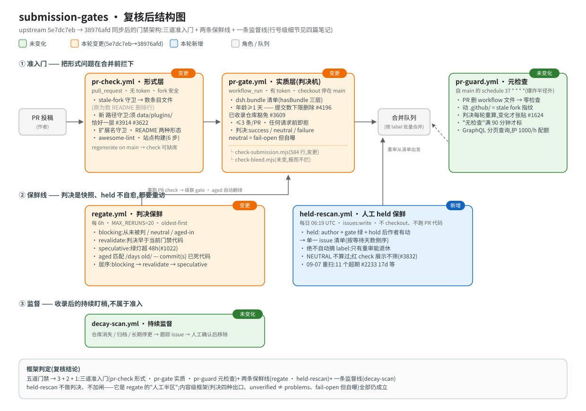

# submission-gates · 提交与门禁

> 状态:**0004 已复核**(门禁逐行重核;行数 pr-check 233→**244**、pr-gate 369→**375**、`scripts/lib/entries.mjs` 243→**281**;regate 369、held-rescan 258、`pr-guard.yml` 212、`check-submission.mjs` 584、`check-bleed.mjs` 94 **自 0002 基线零 diff**)。最近核验:`b4d0049a8`,2026-10-24。(0003 对本专题是零 diff 同步,故"已复核"从 0002 直接接到 0004。)

*0001 复核产物:三道准入门 + 两条保鲜线 + 一条监督线;绿=未变 / 橙=本轮变更 / 蓝=新增。行号级细节见四篇笔记。0002 未重绘此图(结构不变,变的是门禁内部的判据与例外);0004 同样未重绘——准入层仍是三道,变的是 pr-check 从十步变十一步、共享校验器多了一条字段判据。*

## 定位

一个日均几十个 commit 的注册表,人工 review 是瓶颈也是最后防线。机器门禁的职责因此非常明确:**把形式问题在合并前拦下,并保证「没有核验过」永远不会被读成「已核验」**。这个专题记录六条 workflow + 两个校验脚本(加一个共用的 `scripts/lib/entries.mjs`)如何构成这台防线(0001:结构从"五条门禁"改为 **3 道准入门 + 2 条保鲜线 + 1 条监督线**——held-rescan 不做判决,是队列保鲜线,与 regate 构成"stale green 会被合并"哲学的机器/人工两个半区)。

## 设计原则(从源码与注释中提炼)

1. **fork 安全优先于一切。** 面向 fork PR 的 `pull_request` job 没有 token(`pr-check.yml`),所有需要认证 API 的检查挪进 `workflow_run` 触发的 `pr-gate.yml`,在基础仓库上下文里跑;checkout 永远停在 main,PR 的 YAML 只作为数据被 `git archive` 抽出,**绝不执行来自 PR 的任何代码**(`pr-gate.yml:9-15` 有显式 SECURITY 注释)。0002/0004 新增的四个测试步骤也守这条:注释分别写明 "Pure rules only — no downloads, no scanner, no token" 与 "Pure rules only, no token and no network"。
2. **判决是快照,会过期。** regate 用**七类**理由重跑(0001 只有四类 urgent + passStale):从未被判、判决早于当前门禁代码、被判早于当前**检查代码**、门禁本身跑挂、「时间能解决」的失败、neutral(fail-open 放行的未核验);连绿灯满 48 小时也会被重查。0002 的新论点是**"过期证据"不再专属于 gate**:红 `check` 若比 `check` 自身的代码还旧,也是过期证据(见 [03](./03-regate-and-bleed.md))。
3. **门槛过滤的是仓库,不是投稿动作。** 已收录仓库豁免(`listedReposAt(base)`,从条目**文件名**解析 owner/repo,base 读不到一律视为"全部新仓库"fail-closed)——在自己仓里挪目录的插件不再被重新审判(#1554 的改名绕过检查原样保留:改名落到未收录仓库仍受全量审查)。
4. **fail-open 但必须自曝。** 配额挤兑时条目放行但标 neutral,"nothing here vouches for them";检查器自身崩溃明确写成 failure 而非静默绿("The gate could not run" 现在还会被 regate 认出来并 1 小时后自动重问,#5083)。这条纪律源自 2026-08-18 六个不达标条目因 403 与正常通过不可区分而变绿的翻车。
5. **错误信息替作者写好下一步,并按"谁该动"分向。** 该作者动手的:给可粘贴命令(路径/扩展名错 → `git mv`;子路径写错 → fuzzy 候选目录与修正 YAML;YAML 解析失败 → 文件+行号+"repro"一行命令);时间能解决的:**明说什么都不用做**——age 文案是 "nothing to do: this check re-runs by itself";0002 新增的一类则指向**维护者**:分支与 main 冲突导致 CI 从未运行,补救是 rebase 而非 push(`held-rescan`,#2202)。**0004 的半个例外**:`icon` 的报错只说 "must be hosted on GitHub (got <作者用的主机>)",没把允许的四台主机列出来——"指向正确方向"守住了,"照做就能过"没守住(`entries.mjs:129`)。
6. **每个常量都是事故刻度。** 见各正文中的事故索引。

## 3 道准入门 + 2 条保鲜线 + 1 条监督线

### 准入门

| workflow | 触发 | 权限面 | 职责 |
|----------|------|--------|------|
| [`pr-check.yml`](./01-pr-check-and-guard.md)(244 行) | `pull_request`(含 fork) | 无 token | 形式层(**十一步**):stale-fork 守卫(数条目文件)、`.yml` 扩展名守卫、条目路径守卫、**"只改生成 README 行不算投稿"(0002 新增)**,README 一致性(两种形态、比对 PR head;`generate-readme` 就在这一步跑,**0004 的 `icon` 判据从这儿生效**),awesome-lint,**四个纯规则测试**(0002 三个 + 0004 entry-path),站点构建 |
| [`pr-gate.yml`](./02-pr-gate-and-check-submission.md)(375 行) | `workflow_run: PR check completed` | 有 token | 实质层:dsh.bundle 清单、仓库年龄≥1天、每 PR ≤3 条、已收录仓库豁免、**条目文件必须能被 YAML 解析(0002 新增)**;产出 check-run 判决 |
| [`pr-guard.yml`](./01-pr-check-and-guard.md)(212 行,未变) | schedule `37 * * * *` + 手动 | 元检查 | 抓两类"其他检查根本不会运行"的状态:删掉 workflow 文件的 PR(#1635)、动了 `.github/` 的 stale fork(#1614/#1635) |

### 保鲜线

| workflow | 触发 | 权限面 | 职责 |
|----------|------|--------|------|
| [`regate.yml`](./03-regate-and-bleed.md)(369 行) | schedule `19 */6 * * *` + 手动 | 重跑驱动 | 机器判决保鲜:**七类理由**(never/stale/aged/unverified/**faulted**/**checkStaleRed** + passStale),调度三层 blocking→revalidate→speculative,每轮 ≤20 次 |
| [`held-rescan.yml`](./02-pr-gate-and-check-submission.md)(258 行) | schedule `19 6 * * *` | issues:write | **人工 held 保鲜**:每日列出"已修好仍挂 `held: author`"的 PR 到单一 tracking issue;**0002 起把"CI 从未运行"(分支与 main 冲突,无 merge ref)也入列**,新增 gate 列 ✅/—,NEUTRAL 仍不算过;**绝不自动摘 label** |

### 监督线

| workflow | 触发 | 权限面 | 职责 |
|----------|------|--------|------|
| `decay-scan.yml` | 归 [probes-and-decay](../probes-and-decay/00-map.md) | — | 收录后的持续监督,不属于准入 |
| `site-health.yml`(0002 新增) | schedule `23 7 * * *` | contents:read | 盯**线上字节**:页面数落后 catalog 超过 tolerance(300)即红,归 [site-surface](../site-surface/00-map.md) |

> 口径注:本专题覆盖六条 workflow——三道准入门 + regate/held-rescan(保鲜线)+ decay-scan(监督线);`build-site.yml` 归 site-surface、`sync-readme.yml` 归 readme-pipeline、`adopt-discussions.yml`/`site-health.yml` 分别归 [probes-and-decay](../probes-and-decay/00-map.md) 与 [site-surface](../site-surface/00-map.md)(后两条不在本专题的六条里)。全仓 workflow 总数 0001 八条 → 0002 **十条**。

配套脚本:[`check-submission.mjs`](./02-pr-gate-and-check-submission.md)(584 行,实质校验,未变)、[`check-bleed.mjs`](./03-regate-and-bleed.md)(94 行,描述串染检测,#1348,未变),以及两者都要经过的共享层 `scripts/lib/entries.mjs`(0004 起 281 行):`readEntries()` 决定条目的 `file` 长什么样,`validateEntries()` 决定一个条目文件允不允许存在——0004 新增的 `icon` 判据就在这里(`:116-134` 定规则、`:247-253` 接入主循环)。

## 评审哲学(contributing.md 是合同,CI 只是前置条件)

"CI 通过是前置条件,不是结论"(contributing.md:92)。**八个评审维度**(0001:+7 纯聚合包不单收;+8 依赖须指向原作者):描述与代码一致、分类合理(永不打回,维护者直接改)、真实可用代码、是否重复收录(规则不是先来后到,是谁更好)、源码无可疑行为(常识检查而非安全审计)、PR 不碰无关条目、聚合包、依赖归属。

**0002 更新**:≤3 条上限的论据被重新称量——contributing.md:154 现在写"当初定这个余量时"是 92×1 / 8×2,而 **2026-09-24 对最近 100 个"新增过条目"的 PR 重数得 88×1、3×2、9×3**。也就是"没人一次加 3 条"已不成立,余量正在被真实使用(多子包 monorepo)。contributing 另保留两条投稿方预防性警告:tarball 用 `latest/download/`+版本名资产 = 下次发版即 404 的静默腐烂;peerDeps 不带显式预发布分支会静默排除 prerelease。表述基调不变:「我们不是插件好坏的裁判」。

## 0002 新增的三条规则(同一家族)

1. **名字即链接**:写成 owner/repo 的 `name` 必须等于 url 的 owner/repo(`entries.mjs:195-208`,#5756——查出 6 条名不副实、其中 5 条的"名字仓库"根本不存在)。
2. **README 行不是投稿**:PR 改了生成区里的插件行却没带任何 `data/plugins/` 变更 → 拒(`pr-check.yml:111-157`,#5845/#3168)。抓两种形态:作者写好了 yml 但 `git commit -a` 没把它加进去(新文件不被 -a 记录);或仓库早已收录,只有重生成的行在动。
3. **名字对但内容不是 YAML**:pr-gate 现在逐个解析变更的 `.yml` 并报 `文件:行号`(#4680,一条 `zh:` 行是 GBK 乱码挂在这里五天)——"readEntries() 会静默丢掉这个文件"。

三者与 0001 的"四道防污染屏障"同一个信条:**机械检查全绿 ≠ 内容没坏;凡是机器说不了的,就把它摆到评审眼前。**

**0004 新增的一条(同一家族,落点在 pr-check):`icon` 必须是 GitHub 托管的位图。** 作者可写的键从五个变六个(`file` 不在其列——那是 `readEntries()` 加的)。`ENTRY_KEYS` 是**封闭集合**(`entries.mjs:166`):多写一个键就给这个文件记一条 problem,`generate-readme` 随即拒绝生成,报错里还会列出允许的键。正因为键集是封闭的,这个特性必须同时改两处——把 `icon` 加进白名单,以及在 `validateEntries()` 里接一条判据(`entries.mjs:247-253` → `iconProblem()` `:116-134`)。判据是四个条件的合取:(1) 非空字符串且能 `new URL()` 解析;(2) 协议为 `https`;(3) `hostname` **精确等于**四台之一——`raw.githubusercontent.com`、`user-images.githubusercontent.com`、`camo.githubusercontent.com`、`github.com`;(4) `pathname`(小写后)以 `.png`/`.jpg`/`.jpeg`/`.webp` 结尾。

由此被拒的形状:非字符串/空值("must be a URL string")、解析不了("is not a valid URL")、http("must be https")、异地主机("must be hosted on GitHub (got X)")、任何非位图后缀。**SVG 没有专门分支**,是被第 4 条挡下的——报错落在 "must point at a raster image"。判据读的是 **URL 字符串而不是字节**:`https://github.com/<owner>/<repo>/blob/main/icon.png` 主机与后缀都满足、一路通过,但它取回来的是 HTML 页面;真正兜底的是消费端(提交信息写明 dsh-market 在"字段缺失**或图片加载失败**"时回退作者头像)。当前 13 条条目带 `icon:`,基线是 0 条。

落点值得记一笔:它**不在 pr-gate**,而在 pr-check 第 5 步——`generate-readme.mjs:95` 调 `validateEntries()` 并 `exit 1`("N problem(s) in data/plugins — refusing to generate.")。所以非法 `icon` 让 `PR check` 变红,而 `Submission gate` 那枚判决完全不动:`check-submission.mjs` 一行都没读 `icon`。契约面还剩两处缝(见 [01](./01-pr-check-and-guard.md)):contributing 只说"GitHub 托管",没列四台主机(`contributing.md:169-173`);模板里的 `icon:` 是一条**活的**示例 URL(指向 `owner/repo/main/assets/icon-180.png`),照抄不会报错,但九成是 404——而 404 在判据里是合法输入。

## 待回答的问题

- [x] check-bleed 查什么 → 见 [03](./03-regate-and-bleed.md):跨条目共享 40 字符以上描述文本即报,报而不拦
- [x] 哪些规则给出自动修正建议 → 子路径修正、根指向改子包、stale-fork 三行修复命令、**0002:非法 YAML 的文件+行号与复现命令**
- [x] ISSUE_TEMPLATE 关系 → 问题分流模板:市场 UI 问题去 dsh-market,dsh 本体问题去官方仓,插件 bug 去插件自己仓库;本仓库只收"清单本身坏了"
- [x] ~~decay scan 如何执行"经确认后移除"的人工环节~~ → 见 [probes-and-decay/02](../probes-and-decay/02-scan-decay.md)(flag-only,人在 tracking issue 里决定)
- [ ] **0004 重问**:`dsh-trust-check` 本身是已收录插件(`data/plugins/liuwenji007__dsh-trust-check.yml`),又被写成 CI 的 devDependency(0004 从 `^0.1.13` 升到 **`^0.2.1`**)——"自食其粮"是否需要在 contributing 里写明政策。更要紧的是**可核性**:本仓能核的只有"钉了哪个版本、怎么调、消费哪些字段";`0.2.1` 的检测规则与分类逻辑在 npm 包里,核不了。它判的又正是我们发布出去的能力披露——这层不透明记在 [01](./01-pr-check-and-guard.md) 的 pr-check 一节。
- [ ] **0004 新增**:`icon` 判据只看主机与 URL 后缀,不看字节——`github.com/.../blob/...png` 能过检却取回 HTML;是否要在门禁里区分 raw/blob,还是继续把"图挂了回退头像"全交给消费端。
- [ ] **0002 新增**:README-row 守卫是否会对"合法地同时改生成区与手写区、但不带条目"的 PR 误伤(注释自称按行作用域,未实测)
