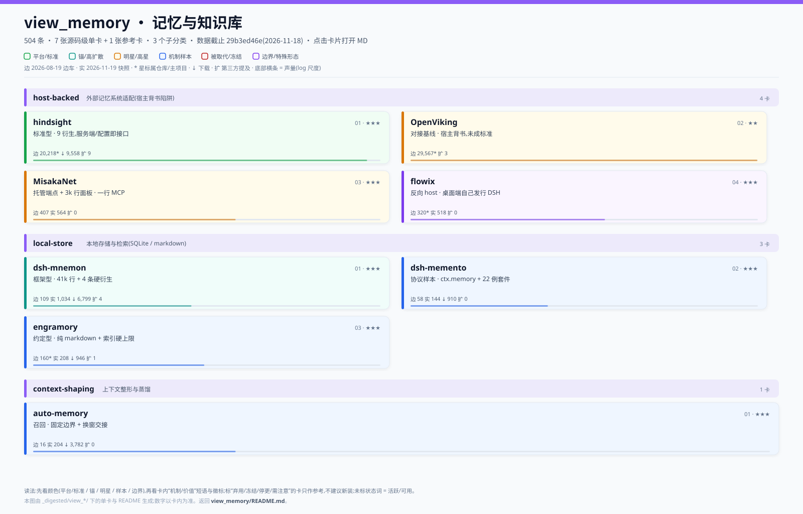

# view_memory — 记忆与知识库

> 已立册(546 条 / 新增 45 / owners 510、单件 94%)。⚠ 星标为历史采样。数据截止 `8f1a1800e`(2026-11-25)。

> 健康/衰减:见 [`_data/health.md`](../_data/health.md)(2026-11-19 快照)。状态词定义见 [`../AGENTS.md`](../AGENTS.md) §二。
> 抽样框:本册卡是**目的性抽样**(锚 + 机制例外),不是随机样本;不能用于估计领域内比例。

**状态优先**:本册 7 张源码级卡 + 1 张参考卡(OpenViking ★★)都还在维护或可用;真正要选型时先看"数据存哪"(见下方隐私提示),再看是框架(mnemon)、协议(memento)、约定(engramory)还是托管端点(MisakaNet/flowix/hindsight)。

**怎么读这张图**:7 张源码级卡 + 1 张参考卡按子分类排列;颜色是**角色/价值型**(平台/标准、锚、明星、机制样本、边界),不是质量排名。`边` = 2026-08-19 边车星标(⚠ 历史值),`实` = 2026-11-19 快照星标,`*` = 星标属仓库/主项目,`↓` = 下载,`扩` = 第三方提及;底部横条只是声量 log 尺度,不要当分数。点击图中卡片进单卡;渲染器不支持 SVG 内链时,用下方子分类表进入。未标状态词 = 活跃/可用。

## 读者与价值

- **谁该读**:要长期记忆/RAG、不想每次重述上下文的人;以及做记忆后端的作者。
- **解决什么**:知识散落在会话/笔记/外部服务;跨会话失忆;托管服务带来隐私与锁定。
- **适用面**:本地优先、可自托管、能接受召回不完美;不适合强合规云、多用户共享、要求零误召的场景。
- **业务价值**:连续性与可检索;代价是数据治理、召回质量与存储成本。先看"数据存哪",再看机制。

## 快照

中盘类目,本期 546 条:上期 504 → 净 +42(新增 45 / 删除 3),占比 −0.1pp 匀速;owners 510、单件 94%,多样性尚可。

## 锚(存量头部,⚠ 星标历史采样)

| 条目 | 星标 | 说明 |
|------|------|------|
| volcengine/OpenViking#examples/dsh-memory-plugin | 29567 | ⚠ 宿主背书型:星标属于 OpenViking 主项目,非插件热度([02](host-backed/02-openviking.md) ★★) |
| vectorize-io/hindsight#coding-agents | 20218 | 同上,hindsight 主仓背书([01](host-backed/01-hindsight.md) ★★★) |
| Ikalus1988/MisakaNet | 407 | **主项目背书型**:跨 13 宿主失败知识库,DSH 是第 12 个;不是"纯社区最高"([03](host-backed/03-misakanet.md) ★★★) |
| text2future/flowix#dsh-flowix-memory | 320 | **反向 host**:Flowix 桌面端自己发行 DSH,插件只是它 profile 里一行 MCP([04](host-backed/04-flowix.md) ★★★) |
| tinqiao-oss/engramory#plugin | 160 | 纯 markdown 目录 + 索引硬上限;DSH 侧 0 工具、0 依赖([03](local-store/03-engramory.md) ★★★) |

## 子分类(册内目录)

| 子分类 | 定义 | 成员数(已确认) |
|--------|------|----------------|
| [host-backed](host-backed/README.md) | 外部记忆系统适配(宿主背书陷阱) | 4 例,12 个第三方条目(9 hindsight + 3 OpenViking;7 同名) |
| [local-store](local-store/README.md) | 本地存储与检索(SQLite/markdown) | 5 例 |
| [context-shaping](context-shaping/README.md) | 上下文整形与蒸馏 | 2 例 |

单卡落在子分类目录内:`<子分类>/NN-<slug>.md`;本册已有 8 张单卡(host-backed 4、local-store 3、context-shaping 1),其中 **7 张 ★★★ + 1 张 ★★ 参考卡(OpenViking,未读源码)**。

## 本期动向

新增 **45 条**(0006 窗口 164)。新增几乎全是**本地优先长期记忆**:Markdown/SQLite/FTS5、分层/衰减/巩固、人物画像/日记。候选:

- `HANPU5838/dsh-memory`(11 个 memory_* 工具、4 条召回通道)、`emo-bird/dsh-deepmemory`(跨会话 SQLite + 日记)、`JqandCl/dsh-memory-huixiang`(会衰减/增强的卡片)、`xkshct198570/dsh-whale-memory`(SQLite 召回 + 写审计 + 六 tab)、`howtomakeaname/dsh-memory-service`(FTS5 + revision)。
- 方向:从"接一个外部记忆服务"转向"**自己存、自己召回、可审计**"。这与本册 `local-store` 的定义重合,暂不新开子分类;下一轮从中挑 1–2 个有安装/扩散证据的立卡。

## ⚠ 隐私提示

本领域三个头部(hindsight、OpenViking、MisakaNet)都依赖**外部服务**。hindsight 默认后端为 Cloud,装完即上传会话内容;OpenViking 需 `viking://` 服务端;MisakaNet 默认 MCP 行指向 `misakanet.org`,并把查询前 80 字符写入托管端的 `search_signals`。engramory 则是明文 markdown 落盘,放在项目里必须 git-ignore。引用"记忆能力"时,先确认数据存哪——这是选择记忆插件比选工具更要紧的一条。

## 稳定性判读

memory 的头部被三个机构级宿主项目占据,读数时要**把"宿主项目火"与"插件被用"分开**(数字口径见 [`_method/00-index.md`](../_method/00-index.md))。源码级卡片修正了一条旧判断:**MisakaNet 不是"纯社区侧最高"**——它的 407 ⚠ 星(实时读数更高)属于一个支持 13 个宿主的失败知识库,DSH 适配层只有一行 MCP 行 + 3005 行面板,扩散为 0。

扣除三个宿主背书型后,社区侧的真实头部是 `dsh-mnemon`(109 ⚠,实时读数显著更高;同一仓库、无宿主稀释)、`dsh-memento`(58 ⚠,同样高于边车值)与 `engramory#plugin`(160 ⚠,仓库级、多宿主协议,DSH 层只占一部分);前者有硬衍生,后者有可分发协议套件但第三方采纳为 0,engramory 的唯一衍生是照文档重写而非依赖。**context-shaping 只剩一张活跃卡**:auto-memory 把"何时想起"交给宿主规则;模型驱动压缩的 DSH 原生实现(billion-context-dsh)已停维护、指向官方上游,不立卡,避免把死路当选项。**社区侧记忆方案同样未收敛**,与 session 类似但供给量小一半。RAG/知识库标签本期 +96(见 [01-emerging](../_view/01-emerging.md)),供给端在加速,锚位竞争未定。
