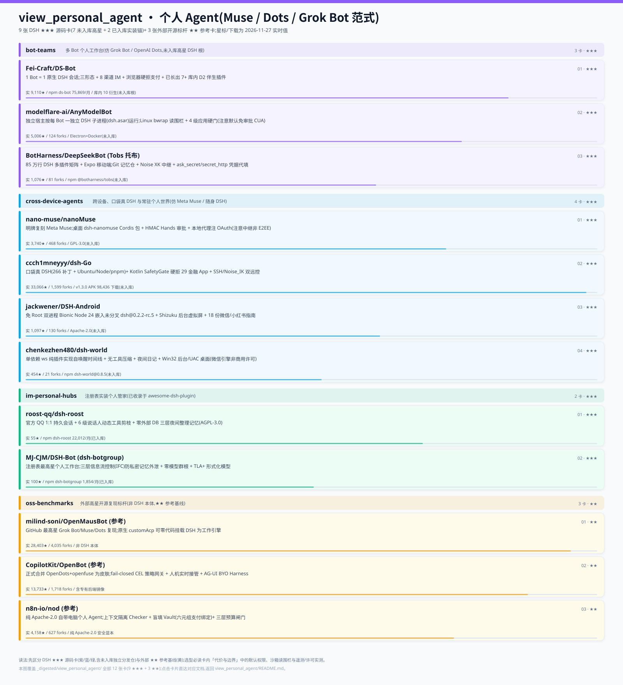

# view_personal_agent — 个人 Agent(Muse / Dots / Grok Bot 范式)

> 状态:**已立(前沿跨域专题),9 张 DSH ★★★ 源码卡 + 3 张外部开源标杆 ★★ 参考卡(共 12 卡)**。注册表基线 `main@8f1a1800e`(2026-11-25,13,136 条);实时星标/下载与源码 HEAD 均为 **2026-11-27** 实测值(见 [`_data/health.md`](../_data/health.md))。
> **收录口径声明**:本册收录的是**影响面大、近期活跃、支持 DeepSeek Harness 的真实 Personal Agent**(不局限于 `awesome-dsh-plugin` 已入库名单);9 张 ★★★ 源码卡中有 **7 个高星项目尚未收录于 `awesome-dsh-plugin/data/plugins/`**(多以独立桌面端/手机端/多 Bot 平台发布在 GitHub),每张卡顶部均已显式标清「未收录于注册表 / GitHub 独立分发」,不与注册表分母混淆。



## 读者与价值

- **谁该读**:想把 DSH 变成 24/7 常驻个人数字助手(对标 Meta Muse / OpenAI Dots / xAI Grok Bot)的个人重度用户、独立开发者,以及正在设计多 Bot 工作台、移动随身宿主、个人记忆与安全审批围栏的插件作者。
- **解决什么**:此前只按 `data/plugins/` 窄词搜索看到 11 条碎片条目,误以为 DSH 生态缺少个人 Agent;实际上高星落地集中在“未入库 `awesome-dsh-plugin` 的独立宿主/跨端/多 Bot 仓”与“外部开源复现”。本册用源码级证据把**真正跑起来的高影响方案、各自的安全真边界与别踩的坑**一次摊平。
- **适用面**:需要跨 IM/手机/电脑常驻、长期个人记忆、浏览器或真实 App 操控、并且看重出站审批与凭据隔离的个人与小团队;不适合只做 GitHub/工单工程派活的研发团队(去 [view_proactive_agent](../view_proactive_agent/README.md)),也不适合只要动漫桌宠/陪聊皮肤的读者。
- **业务价值**:直接拿走源码验证过的 9 套 DSH 落地架构与 3 套外部开源标杆(如 `DS-Bot` 的 D2 伴生插件环、`dsh-Go` 的原生 Kotlin `SafetyGate`、`MJ-CJM/DSH-Bot` 的三层 IFC、`n8n-io/nod` 的盲填 Vault),避开实测挖出的默认免审批 CUA、非商用微信引擎许可冲突、安卓不可关 DAU 心跳与非 E2EE 明文云同步等暗坑。
- **读法**:每张卡先读前三节(问题 / 适用面 / 业务价值)与一屏事实,再看技术实现与「代价与边界」;3 张外部标杆参考卡(`oss-benchmarks/`)仅 ★★ 文档核验,专门对照补齐 DSH 尚缺的机制。

## 为什么单独一册(以及为什么不是 `view_proactive_agent`)

2026 年 8–11 月,**Meta Muse**(独立安全 VM + Sentinel 污点追踪 + WhatsApp/IG)、**OpenAI Dots**(专属云电脑 + 4,000 连接器 + Custom Rules 4 级自主度 + 后台 Dreaming 记忆)与 **xAI Grok Bot**(共享云主机多 Bot 名册 + 无 API GUI 操控 + Teach-a-Task 录屏建技能)共同定义了 **Personal Agent** 新品类。

它与同级前沿专题 [view_proactive_agent](../view_proactive_agent/README.md)(基于 `deepseek-ai/dsh-superagent-prototype`)解决的是**完全不同的读者问题**:

| 对比轴 | **view_personal_agent**(本册) | [view_proactive_agent](../view_proactive_agent/README.md) | 桌宠 / 陪聊皮肤(`fun`/`identity`) |
|---|---|---|---|
| **核心问题** | 一个 24/7 常驻数字代理人,如何跨设备/IM/App 安全地替**我**持续处理生活与工作? | 外部谁有资格发起工单、凭什么 Mandate 放行、在哪隔离跑、干完回哪条线程? | 它“像谁”(人设、Live2D、物理挂件)? |
| **状态中心** | **人**(纵向个人记忆 + 持久设备/浏览器登录态 + 多 Bot 个人名册) | **工单**(`Source → Policy/Mandate → Ticket → Ephemeral Worktree → Report`) | 形象 / 好感度 / 聊天壳 |
| **安全主轴** | **出站防越权**(防私密记忆外泄、防未确认外发/支付/改密、凭据对 LLM 不可见、说话人分级围栏) | **入站准入**(Source 白名单、accept mode、Mandate 不可变) | 基本无 |

### 准入定义与显式排除

本册只收**影响面大、近期活跃(2026-11 仍有实质提交)、具备持久记忆/多端常驻/真实行动面与显式安全边界**的 Personal Agent 项目。源码审计已显式排除两类高星“假命中”:

- **排除纯桌宠/皮肤**:例如 `Edge-HH/GrokBot_in_DeepseekHerness`(1★)经核验为可拖拽物理桌宠(`@edge-hh/dsh-grokbot-pet`),非个人 Agent 运行时。
- **排除非 DSH 驱动的“名义支持”大宿主**:例如 **`stablyai/orca`(141,684★)** 虽在文档列出 DSH,但源码实测(`src/shared/bots/bot-record-schemas.ts:22-45` 与 `agent-chat-permission-support.ts:34-57`)其 `BOT_AGENTS` 与 `NATIVE_CHAT_AGENTS` 均**不含 `'dsh'`**——DSH 在 Orca 中仅作终端 `dsh-tui` 包装与 commit 文本生成器,无法驱动 Orca Bots,故不收进本册。

## 子分类与 12 张卡

| 子分类 | 定位 | 已立卡 | 证据级 |
|---|---|---:|---|
| [bot-teams](bot-teams/README.md) | 多 Bot 个人工作台(仿 Grok Bot / Dots,未入库高星 DSH 根) | 3 | ★★★ × 3 |
| [cross-device-agents](cross-device-agents/README.md) | 跨设备、口袋真 DSH 与常驻个人世界(仿 Meta Muse / 随身 DSH) | 4 | ★★★ × 4 |
| [im-personal-hubs](im-personal-hubs/README.md) | 已收录于 `awesome-dsh-plugin` 的实装个人管家 | 2 | ★★★ × 2 |
| [oss-benchmarks](oss-benchmarks/README.md) | 外部高星开源复现标杆(非 DSH 本体,对照借鉴与 ACP/AG-UI 汇合靶标) | 3 | ★★ × 3 (`reference`) |

### 9 张 DSH ★★★ 源码卡

| 卡 | 子分类 | 注册状态 | 一句话 | 实时声量(2026-11-27) |
|---|---|---|---|---:|
| [bot-teams/01-ds-bot](bot-teams/01-ds-bot.md) | `bot-teams` | 未入库(库内 10 衍生) | 1 Bot = 1 原生 DSH 会话;三形态 + 8 渠道 IM + 浏览器硬拒支付 + **已长出 7+ 库内 D2 伴生插件** | **9,110★ / npm 75,869/月** |
| [bot-teams/02-anymodelbot](bot-teams/02-anymodelbot.md) | `bot-teams` | 未入库 | 独立宿主把 `dsh@0.2.1-rc.4` 打成 `dsh.asar` 按每 Bot 一子进程跑;Linux `bwrap` 读围栏 + 4 级应用硬门 | **5,006★** |
| [bot-teams/03-deepseekbot](bot-teams/03-deepseekbot.md) | `bot-teams` | 未入库 | Tobs 托布:85 万行 DSH 多插件矩阵 + Git 记忆 + Noise XK 移动端 + `ask_secret`/`secret_http` 凭据代填 | **1,076★** |
| [cross-device-agents/01-nanomuse](cross-device-agents/01-nanomuse.md) | `cross-device-agents` | 未入库 | 明牌复刻 Meta Muse;桌面 `dsh-nanomuse` Cordis 包 + HMAC Hands 审批 + 本地代理注 OAuth(中继非 E2EE) | **3,740★** |
| [cross-device-agents/02-dsh-go](cross-device-agents/02-dsh-go.md) | `cross-device-agents` | 未入库 | 口袋真 DSH(266 补丁 + Ubuntu/Node/pnpm)+ Kotlin `SafetyGate` 硬拒 29 金融 App + SSH/`Noise_IK` 双远控 | **33,066★ / APK ~10万/版** |
| [cross-device-agents/03-dsh-android](cross-device-agents/03-dsh-android.md) | `cross-device-agents` | 未入库 | 免 Root 双进程 Bionic Node 24 嵌入未分叉 `dsh@0.2.2-rc.5` + Shizuku 后台虚拟屏 + 18 份微信/小红书指南 | **1,097★** |
| [cross-device-agents/04-dsh-world](cross-device-agents/04-dsh-world.md) | `cross-device-agents` | 未入库 | 单依赖 `ws` 纯插件实现自唤醒时间线 + 无工具压缩 + 夜间日记 + Win32 后台/UAC 桌面 | **454★** |
| [im-personal-hubs/01-dsh-roost](im-personal-hubs/01-dsh-roost.md) | `im-personal-hubs` | **已入库** | 官方 QQ 1:1 持久会话 + 6 级说话人动态工具剪枝 + 零外部 DB 三层夜间整理记忆 | **55★ / npm 22,012/月** |
| [im-personal-hubs/02-dsh-bot-mjcjm](im-personal-hubs/02-dsh-bot-mjcjm.md) | `im-personal-hubs` | **已入库** | 注册表最高星个人工作台(`dsh-botgroup`);三层信息流控制(IFC)+ 零模型群根 + TLA+ 形式化模型 | **100★ / npm 1,854/月** |

### 3 张外部开源标杆 ★★ 参考卡(`kind: reference`)

| 卡 | 协议 | 一句话 | 实时声量(2026-11-27) |
|---|---|---|---:|
| [oss-benchmarks/01-openmausbot](oss-benchmarks/01-openmausbot.md) | Apache-2.0(+`enterprise/`) | GitHub 最高星 Grok Bot/Muse/Dots 复现;原生 `customAcp` 可零代码挂 DSH 为工作引擎 | **28,403★** |
| [oss-benchmarks/02-openbot](oss-benchmarks/02-openbot.md) | MIT(+专有后端镜像) | 合并 `OpenDots`+`openfuse` 为多皮肤;fail-closed CEL 策略网关 + 人机实时接管 | **13,733★** |
| [oss-benchmarks/03-n8n-nod](oss-benchmarks/03-n8n-nod.md) | **纯 Apache-2.0** | 自带电脑的个人 Agent;上下文隔离 Checker + 盲填 Vault(六元组支付绑定)+ 三层预算闸门 | **4,158★** |

> 其余高星未立卡观察池:`DSH-APP/DSHA`(3,738★)、`whiteguo233/OpenBiliClaw`(3,830★)、`imsai-sh/fish-pocket`(453★)、`Devin-AXIS/iPolloWork`(7,539★)及注册表内 `hanshanyike/dsh-yolo`(52★)、`Dely0/dsh-personal-workbench`(47★)、`Kevinwu901113/dsh-dot`(19★);以及外部超级网关底座 `openclaw/openclaw`(395k★)、`NousResearch/hermes-agent`(266k★)、`agentscope-ai/QwenPaw`(38k★)、`nearai/ironclaw`(12.7k★)。

## 稳定性与生态缺口判读(源码审计收敛结论)

**供给已大爆发、头部协议锚刚露头、三大结构缺口仍待补齐。** 精读 9 个 DSH 源码仓 + 3 个外部标杆后,给出四条可复核判断:

1. **`Fei-Craft/DS-Bot` 是目前 DSH 个人 Agent 赛道唯一形成真实第三方 D2 契约扩展环的根**:虽本体不在 `awesome-dsh-plugin`,但 `data/plugins/` 里已合并 `dsh-reflex`、`dsh-bot-model-switch`、`dsh-bot-toggle`、`dsh-bot-board` 4 个纯伴生扩展 + 3 个可选集成 + 2 套主题 + 1 个下游分叉,生态结构与 `view_proactive_agent` 的 `dsh-superagent` 高度同构。
2. **文件协议与接入总线正在跨生态收敛**:`SOUL.md` / `MEMORY.md` / `USER.md` 成为 OpenClaw、Hermes 与 DSH 个人 Agent 间的事实通用记忆约定;**ACP + MCP + 腾讯 iLink(WeChat ClawBot)** 成为跨框架互操作主干(`OpenMausBot` 已支持零代码 `customAcp` 挂 DSH)。
3. **DSH 原生沙箱“只拦写不拦读”导致全生态普遍出现跨平台安全断层**:`DS-Bot`(`privacy.js:2-4`)、`MJ-CJM/DSH-Bot`(`workspace-process.ts:4-8`)、`BotHarness/DeepSeekBot`(`store-guard.ts:77-100`)与 `AnyModelBot`(`host.ts:1046-1113`)在源码里**全部撞上了同一堵墙**——Windows、macOS 与 Docker Landlock 下,Shell 命令难以在 OS 层被禁止读取宿主密钥/数据库/其他 Bot 记忆;只有原生 Linux `bwrap` 能补上读围栏。
4. **对照 Muse / Dots / Grok Bot,DSH 生态当前真正的三大蓝海缺口**:
   - **一键持久 MicroVM / 个人云电脑**:外部已有 `daytona`/`cua`/`OpenSandbox`/`E2B`/`microsandbox`/`boxlite`,DSH 侧尚无高星开箱即用 MicroVM 个人云机锚点。
   - **盲填凭证库 + 个人生活级 Sentinel**:除 `DeepSeekBot` 的 `secret_http`/`secret_cli` 与 `nanoMuse` 本地代理外,普遍仍停留在明文落盘或事后脱敏;最干净的公开蓝本在 [03-n8n-nod](oss-benchmarks/03-n8n-nod.md)(盲填 Vault + 六元组支付绑定 + 上下文隔离 Checker)。
   - **消费者级 Teach-a-Task(录屏演示 → 可复用个人技能)**:全网最稀缺,DSH 侧仅见早期原型(`Ottohere-Mourn/TeachReplay` 7★、`dsh-web-recorder` 4★)。

## 与相邻册的关系

| 册 | 关系 |
|---|---|
| [view_proactive_agent](../view_proactive_agent/README.md) | 兄弟前沿专题:那边管「外部来信入站授权与工单派活」,本册管「个人多端常驻、记忆与出站防越权」,严格不混收 |
| [view_memory](../view_memory/README.md) | 通用记忆底层(`dsh-mnemon`、`hindsight`、`dsh-memento`)归 memory 册;本册只分析个人 Agent 的防投毒记忆、私有/群共享边界(IFC)与夜间自我复盘 |
| [view_ui](../view_ui/README.md) | 同作者 `ccch1mneyyy/dsh-TUI` 在 ui 册;移动端完整真 DSH 宿主 `ccch1mneyyy/dsh-Go` 归本册 |
| [view_tools](../view_tools/README.md) | 纯通用浏览器/桌面驱动(`dsh-browser`、`dsh-computer-use`)归 tools 册;带完整个人身份、安全门禁与多端闭环的归本册 |

## 数据与复现

```sh
python3 _digested/ecosystem/live_probe.py --asof 2026-11-27
python3 _digested/ecosystem/view_data.py
node _digested/verify.mjs
```

星标、forks 与 npm 月下载为 2026-11-27 实时采样值;卡内 `repo@commit` 为读源码时的 HEAD。
