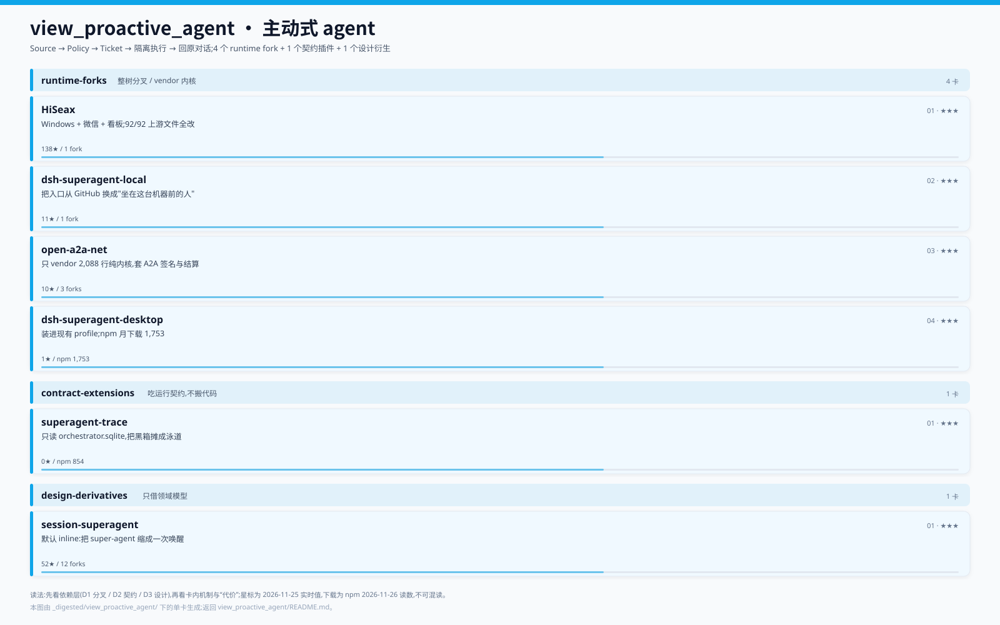

# view_proactive_agent — 主动式 agent

> 状态:**已立(前沿专题),6 张源码级单卡**。数据截止 `main@8f1a1800e`(2026-11-25,13136 条);上游原型 `deepseek-ai/dsh-superagent-prototype@8c32a9dc`(24,565★ / 3,081 forks,实时值)。逐条证据与深读见 [`_faq_on_digested/02_superagent-dependents/`](../../_faq_on_digested/02_superagent-dependents/question.md)。



## 读者与价值

- **谁该读**:团队 lead / 平台工程师,在评估"要不要让 agent 接真实工作";以及写 Source、看板、可观测插件的作者。
- **解决什么**:派活靠人转述、长任务看不见、agent 主动起来又怕失控;现有 CI/机器人只能规则触发,不能"读懂请求→开工作项→隔离执行→回原对话"。
- **适用面**:单仓/单团队、有明确来源(GitHub/飞书/微信/本地会话)、能接受 worker 以 OS 用户执行;不适合多仓、强合规、要求开箱即用的组织。
- **业务价值**:少一次人工转述、每条工单可追踪、授权可审计、执行可隔离;代价是要维护分叉/契约与宿主版本。**星标不是采用**,安装量、issue、被复用才是。
- 读法:每张卡先看前三节(问题/适用面/价值),再看一屏事实与技术细节。

## 为什么单独一册

不是因为它条目多——16 个名字命中、9 个真依赖、3 个设计衍生,体量远低于五领域(最小 546 条)。是因为**读者问题不同**:

- 五领域问"这个插件是什么、怎么接、值不值得装";
- 这里问"**谁能让 agent 自己开始干活、凭什么、在哪执行、干完回哪里**"。

这个问题横跨 workflow(编排)、session(会话)、remote(渠道)、dev(可观测)、ui(面板)。放在 `view_workflow` 下会把 session/remote/dev 的成员硬塞进 workflow;单独成册才能按**依赖层**组织,而不是按官方类目。

## 定义(三条同时成立)

1. 有**外部输入源**(GitHub / 飞书 / 微信 / 本地会话),不是只由当前会话手动派活;
2. 有**准入/裁定**环节(名单、规则、accept mode、Mandate),不是每条消息都执行;
3. 接受后生成**可追踪的工作项**(Ticket/工单),在**独立会话或目录**里执行,结果**回到原对话**。

与相邻概念的分界:

| 容易混的 | 不是本册 | 区别 |
|----------|----------|------|
| multi-agent | 团队协作 | 那边问"多个 agent 怎么分工";这里问"谁让 agent 开始、凭什么" |
| external-engine | 挂外部引擎 | 那边把活交给外部引擎;这里引擎仍是 DSH,变的是入口与授权 |
| session 自动化 | 定时/唤醒 | 那边是"什么时候叫醒会话";这里是"外部请求如何变成受权工作项" |
| 桌宠/陪伴 | 人格化交互 | 那边是"像谁";这里是"能替谁做什么、做到哪一步" |

## 成员与卡

上游根:`deepseek-ai/dsh-superagent`(仓库现名 `...-prototype`)——不在注册表,`private: true` 不发 npm;它定义 Source / Policy / Ticket / Mandate / Assignment / Subscription 的语义。

| 子分类 | 定义 | 注册表成员 | 已立卡 |
|--------|------|-----------:|--------|
| [runtime-forks](runtime-forks/README.md) | 整树分叉或 vendor 上游内核 | 6 | 4 |
| [contract-extensions](contract-extensions/README.md) | 吃 `stateDir`/`orchestrator.sqlite`/Source/profile 契约 | 3 | 1 |
| [design-derivatives](design-derivatives/README.md) | 以领域模型为起点另写实现 | 3 | 1 |

### 六张卡

| 卡 | 层 | 一句话 | 星标 |
|----|----|--------|-----:|
| [runtime-forks/01-hiseax](runtime-forks/01-hiseax.md) | D1 | 92/92 上游源文件全在且全改;把部署面重写成 Windows + 微信 + 看板 | **138** |
| [runtime-forks/02-local](runtime-forks/02-local.md) | D1 | 入口从"GitHub 仓库"换成"坐在这台机器前的人",代价是整树同名 | 11 |
| [runtime-forks/03-nelson](runtime-forks/03-nelson.md) | D1 | 只 vendor 2,088 行纯内核,把 A2A 的签名与结算套在外面 | 10 |
| [runtime-forks/04-desktop](runtime-forks/04-desktop.md) | D1 | 1★ 的薄分叉,把 super-agent 装进你正开着的那个 profile | 1 |
| [contract-extensions/01-trace](contract-extensions/01-trace.md) | D2 | 只读一张库,把 Super-agent 的黑箱摊成泳道图 | 0 |
| [design-derivatives/01-mycf711](design-derivatives/01-mycf711.md) | D3 | 留住管线,换掉记账单位:默认 `inline` 把 super-agent 缩成一次唤醒 | 52 |

未立卡的成员:ctrl439(多仓 + IM 桥)、adapt(0.2.2-rc.3 适配)、wechat-source、power、NattoCB、imperial——材料在 [runtime-forks](runtime-forks/README.md) 与 [contract-extensions](contract-extensions/README.md) 的成员表里,下一轮按证据补。

## 快照与影响力

- 注册表 16 个名字命中:**9 个真依赖**(6 D1 + 3 D2)、3 个设计衍生、4 个只是同名;本册收 12 个。
- 上游 **24,565★ / 3,081 forks**,但 `private: true`、不发 npm;它是这册所有线的语义来源,不是可安装的依赖。
- 依赖者里只有 **HiSeax 138★** 过百星;第二是 D3 的 **MYCF711 52★**(不是依赖),再往下 local 11、nelson 10。
- **星标不是唯一量纲**:desktop 1★ 但 npm 月下载 **1,753**、周 380;trace 0★ 但 npm 月下载 854;mycf711 52★,npm 线在 11-25/26 从 0.10.12 跳到 2.0.2(2.0.0 已发,是否等于所读 commit 未验证);HiSeax 138★ 却只能 clone/`link:` 装。
- 这册没有"千星锚";它的影响力是**定义一个品类**——上游把 Source/Policy/Ticket 写成可讨论的模型,下游在补部署面。

## 稳定性判读

**有供给、有分叉、没有协议复用。** 六张卡读下来,收敛信号只有一条:**人保留验收权**(MYCF711 的 ack、HiSeax 的 grill 卡、imperial 的批红)。再往下:

- **D1 分叉各补一个部署面**,没有一家全补:HiSeax=Windows+微信+看板,local=本机工作区,desktop=现有 profile,nelson=A2A,ctrl439=多仓+IM,adapt=宿主版本。它们复用的是同一套领域模型,不是同一个插件接口。
- **D2 吃的是事实契约,不是公开 API**:trace 读 `orchestrator.sqlite` 6 张表 + 3 个 kv 族,wechat-source 实现 `SourceKind`,power 依赖 profile + `bridge.js`。上游改形状,它们不会编译失败,只会"页面正常、数据为空"或起不来。
- **D3 证明语义可脱离实现**:MYCF711 默认 `inline`,把 Ticket 换成"水位+唤醒",同时牺牲可移交主体、Mandate 版本、Subscription 扇出、结构化 Report 四样;它自己的 `official-decomp` 记录了这次漂移。
- **没有第三方复用同一份 schema/存储布局/调度语义**——按本册标准,还谈不上"标准成形"。

## 与五领域的关系

| 册 | 关系 |
|----|------|
| [view_workflow](../view_workflow/README.md) | 本册从它的 `proactive-agent` 候选升级而来;workflow 只留一句指针 |
| [view_session](../view_session/README.md) | MYCF711 的"会话级唤醒"是 D3 成员;session 册负责会话生命周期,不重复本册的授权分析 |
| [view_tools](../view_tools/README.md) | 渠道/桥接类工具若只做 Source 不建工单,仍归 tools |
| `view_remote`(未立) | 微信/飞书渠道目前寄在本册;remote 立册后再交叉登记 |

## 数据与复现

```sh
grep -ril 'superagent\|super-agent\|super_agent' data/plugins | wc -l   # 16
git ls-remote https://github.com/deepseek-ai/dsh-superagent HEAD       # 8c32a9dc…
python3 _digested/ecosystem/census.py                                  # 13136 条
python3 _digested/ecosystem/view_data.py                               # cards.json / health.md
```

星标/forks 与下载为 2026-11-25/26 实时值;注册表计数来自 `main@8f1a1800e`。卡内 `repo@commit` 是读源码时的 HEAD。
