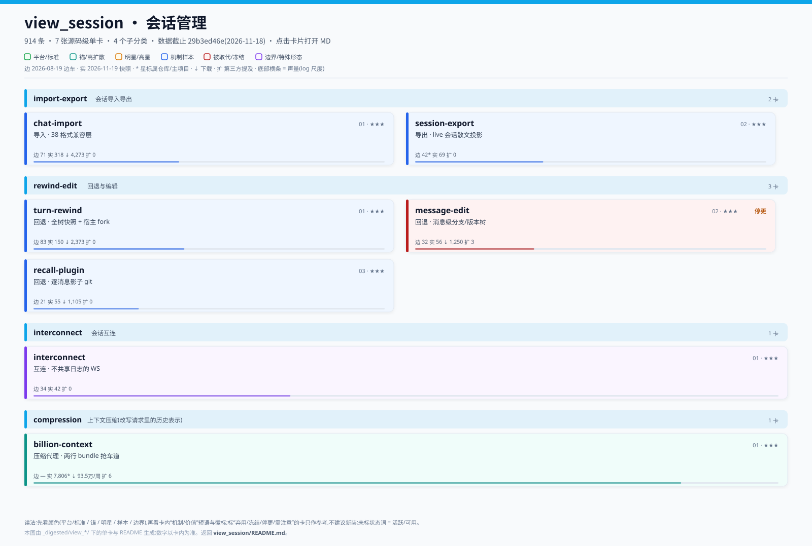

# view_session — 会话管理

> 已立册(1024 条 / 新增 111 / owners 931、单件 92%)。⚠ 星标为历史采样。数据截止 `8f1a1800e`(2026-11-25)。

> 健康/衰减:见 [`_data/health.md`](../_data/health.md)(2026-11-27 实时快照)。状态词定义见 [`../AGENTS.md`](../AGENTS.md) §二。
> 抽样框:本册卡是**目的性抽样**(锚 + 机制例外),不是随机样本;不能用于估计领域内比例。

**状态优先**:`message-edit` 已停更(0 测试、3 处疑似不兼容),不建议新装;其余 6 张在各自路线里仍是可用样本。压缩代理 `billion-context` 的 7,853 星(2026-11-19 快照)属主项目,不是 DSH 适配层。

**怎么读这张图**:7 张卡按子分类排列;颜色是**角色/价值型**,不是质量排名。`边`/`实`/`*`/`↓`/`扩` 见卡内日期;横条只是声量 log 尺度。`message-edit` 标 **停更**——只作"消息级分支"机制参考,不建议新装;`compression` 是新轴,压缩代理的真实影响面在"代理层"而不是插件接口。未标状态词 = 活跃/可用。

## 读者与价值

- **谁该读**:会话很多/很长、需要找回历史或跨工具迁移的人;以及做会话管理插件的作者。
- **解决什么**:上下文爆、历史找不到、换工具要重开;手动复制粘贴不可持续。
- **适用面**:本地/桌面、能接受格式差异与一次导入;不适合需要团队共享、强合规审计的场景。
- **业务价值**:可恢复、可检索、可迁移;代价是格式漂移与宿主版本。压缩/导入/回退是本册三条主线。

## 快照

第三大类,本期 1024 条:上期 914 → 净 +110(新增 111 / 删除 1),占比 +0.0pp 匀速。本轮新 owner 榜以 browser/tools 为主,session 不是主要进场方向。

## 锚(存量头部,⚠ 星标历史采样)

| 条目 | 星标 | 说明 |
|------|------|------|
| Anionex/dsh-turn-rewind | 83 | 类内最高;全树快照 + 宿主 fork 回退([01](rewind-edit/01-dsh-turn-rewind.md) ★★★) |
| Nwflower/dsh-chat-import | 71 | 38 种来源格式导入 + 反向导出([01](import-export/01-dsh-chat-import.md) ★★★) |
| whyihaveyou/dsh-suite#plugin-session-export | 42 | monorepo 子包;live 会话投影成散文 MD/HTML([02](import-export/02-dsh-session-export.md) ★★★) |
| Chinesezjc/dsh-interconnect | 34 | 跨实例 WebSocket 投递([01](interconnect/01-dsh-interconnect.md) ★★★) |
| Moeblack/dsh-message-edit | 32 | 消息级分支 + 版本树([02](rewind-edit/02-dsh-message-edit.md) ★★★) |
| ranxianglei/billion-context | — | ⚠ 边车无记录(采样缺口);2026-11-19 快照 7,853 属主项目;压缩代理([01](compression/01-billion-context.md) ★★★) |

## 子分类(册内目录)

| 子分类 | 定义 | 成员数(已确认) |
|--------|------|----------------|
| [import-export](import-export/README.md) | 会话导入导出 | 2 例 |
| [rewind-edit](rewind-edit/README.md) | 回退与编辑 | 3 例 |
| [interconnect](interconnect/README.md) | 会话互连 | 1 例 |
| [compression](compression/README.md) | 上下文压缩(改写请求里的历史表示) | 1 例 |

单卡落在子分类目录内:`<子分类>/NN-<slug>.md`;本册已有 7 张单卡(rewind-edit 3、import-export 2、interconnect 1、compression 1),均为 ★★★。

## 本期动向

新增 **111 条**(0006 窗口 352;本轮 8 天)。新增不再集中在"压缩/导入导出",而是**会话生命周期与检索**:

- **管理**:删除/归档/回收站(`EndlessPoem/dsh-session-delete`、`Lingliqeye/dsh-session-revenant`)、每日备份(`Maybe-Zero-not-one/dsh-daily-backup`);
- **检索**:全历史搜索(`IvesCheung/dsh-search-everything`、`Noeau-AI/dsh-history-search`);
- **交接**:上下文阈值自动交接(`1502074527-svg/dsh-handoff-at-75`)、会话编排/信箱(`7nian173/dsh-session-orchestrator`);
- **旁路问答**:`BullyHigh/dsh-side-ask`。

这些多数没有星标读数;共同信号是**竞争点从"压缩算法"转向"能不能找到/接上/清掉一条会话"**。本册暂无对应子分类,候选 `session-control`(生命周期 + 检索);下一轮按成员数与安装证据决定是否立册。

## 稳定性判读

**供给第三大、锚最弱**:1024 条的类目,头部只有 83 星,无千星、无五百星。这说明 session 领域处于"需求已被广泛感知、方案尚未收敛"的阶段——导入/导出/回退/压缩各家各做各的,没有出现公认实现。**这是五个已立册领域中不确定性最大、也最值得跟踪收敛信号的一个**。

**七张单卡读完后,这个判断没有变,但边界更清楚**:七者都**没有被第三方复用出协议面**;但"零协议复用"不等于"零提及"——message-edit 有 3 个第三方条目引用(2 个明示谱系的 fork + 1 个 vendor 集成),billion-context 有 6 个(多为清理/兼容工具),逐条判定见各自卡内。回退有三条互不相同的路线——整轮次的工作树快照 + 会话 fork(turn-rewind)、消息级分支 + 版本树投影(message-edit)、逐消息影子 git 快照 + 官方 fork(recall-plugin);导入是逐家存储契约的兼容层(chat-import);导出是 live 会话的散文投影(session-export);互连是一条不共享日志的私有 WebSocket(interconnect);压缩则是**夹在宿主与模型 API 之间的本地代理**(billion-context),DSH 侧只用两行 bundle 条目接管压缩车道。

七个方向都没有可被第三方复用的协议面,所以"零**协议**扩散"是结构性的,不能读成"没人用"——其中导入的下载量是 session 类第一,导出簇有 6 个互不相干的独立实现,压缩主项目则有远高于边车的实时星与周下载。**唯一可能改变格局的是 compression**:它不在插件接口层收敛,而是在"代理改写请求"这一层;若其它宿主也接受同一套 acp 协议,才谈得上标准。
