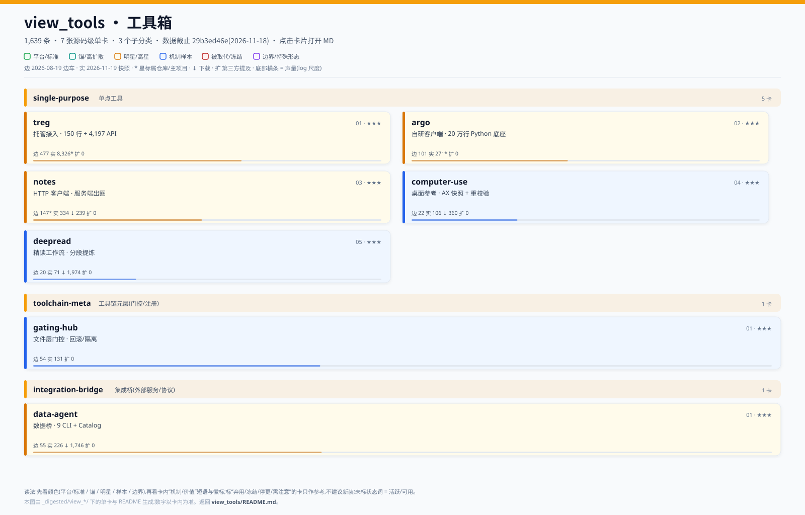

# view_tools — 工具箱

> 已立册(1639 条 / 新增 586 / owners 1254、单件 87%)。⚠ 星标为历史采样。数据截止 `29b3ed46e`。

**状态优先**:本册 7 张卡都在维护或可用;但"高星"多数属主项目(treg/notes/argo),选型应优先看下载、测试与机制密度(computer-use/deepread),而不是星标。

**怎么读这张图**:7 张卡按子分类排列;颜色是**角色/价值型**,不是质量排名。`边`/`实`/`*`/`↓`/`扩` 见卡内日期;横条只是声量 log 尺度。tools 的"高星"多数属主项目,图上用 `*` 标出;真正属于插件的是下载、测试与机制密度。未标状态词 = 活跃/可用。

## 快照

第二大类;本期占比 +0.6pp(头部类目中加速最明显)。owners 1254、单件 87%——头部类目里 owner 多样性最好。

## 锚(存量头部,⚠ 星标历史采样)

| 条目 | 星标 | 说明 |
|------|------|------|
| superdesigndev/treg | 477 | 类内最高,但**不足千星**;星标属主项目,DSH 面仅 150 行([01](single-purpose/01-treg.md) ★★★) |
| zhaoolee/notes#dsh-plugin | 147(仓库级) | monorepo 子包;808 行 HTTP 客户端,PNG 在服务端渲染,默认出网([03](single-purpose/03-notes.md) ★★★) |
| taxueseek/argo#dsh-plugin | 101 | 统一搜索 + 证据核验;插件 6,561 行,主项目约 20 万行 Python([02](single-purpose/02-argo.md) ★★★) |
| omdsh-dev/dsh-data-agent | 55 | 九种数据库 CLI 执行面 + 版本化 Catalog;下载 1,746([01](integration-bridge/01-dsh-data-agent.md) ★★★) |
| Noob-stupid/dsh-plugin-gating-hub | 54 | 文件层升级门控;无 `ctx.provide`,不是调用链锚([01](toolchain-meta/01-gating-hub.md) ★★★) |

## 子分类(册内目录)

| 子分类 | 定义 | 成员数(已确认) |
|--------|------|----------------|
| [single-purpose](single-purpose/README.md) | 单点工具 | 5 例 |
| [toolchain-meta](toolchain-meta/README.md) | 工具链元层(门控/注册) | 1 例,潜在锚 |
| [integration-bridge](integration-bridge/README.md) | 集成桥(外部服务/协议) | 1 例 |

单卡落在子分类目录内:`<子分类>/NN-<slug>.md`;本册已有 7 张单卡(single-purpose 5、toolchain-meta 1、integration-bridge 1),全部 ★★★。

## 本期动向

新增 586 条;新 owner 榜中 zjukop3(tools×12,单类目重度)、lucagiftzek(tools×4)、liufeicc、Threadripper123(tools×3)以 tools 为主要落点。tools 的"杂类工具箱"定位使其承接了最多无法归类的供给——按 [ecosystem/01](../ecosystem/01-scenario-taxonomy.md) 的说法,这是"agent 的手"类目的惯常形态。

## 稳定性判读

供给稳定、人多,但**缺头部**:477 星的锚与类目体量(1639 条)不成比例,中部与尾部无分层。适合关注"谁能先跑出千星"。

**七张单卡读完后,"缺头部"要加一句限定**:treg 的实时星标远高于边车值,但那是托管主项目的星标,DSH 适配层只有 150 行;argo 的主项目也在涨,插件是 6,561 行客户端;notes 的星标同样属主仓库,插件只有 808 行且默认出网;computer-use 的 ⚠ 星标只有 22,但实时月下载 6,570、182 个测试;deepread 的 ⚠ 星标 20、下载 1,974,是把精读做成流水线的工作流型工具。**tools 仍然没有"插件被当作标准"的千星锚**。七种头部形态各自成立——托管接入点(treg)、自研客户端(argo)、服务端渲染 HTTP 客户端(notes)、桌面控制参考实现(computer-use)、精读工作流(deepread)、数据接入桥(data-agent)、文件层门控(gating-hub)——但都不是被第三方依赖的调用链元层。判断:tools 的头部竞争会继续分散,"杂类收纳"的定位没有改变。
