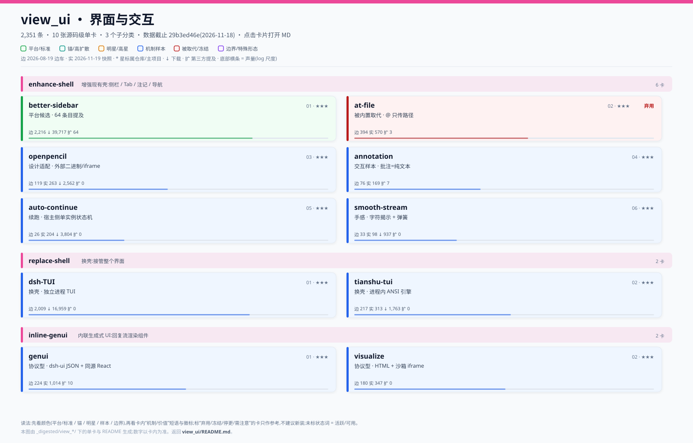

# view_ui — 界面与交互

> 已立册(2351 条 / 本期新增 812 / owners 2017、单件 88%;门槛为默认值,定义见 [`../AGENTS.md`](../AGENTS.md) §二)。
> ⚠ 星标为历史采样。数据截止 `29b3ed46e`(2026-11-18)。

**状态优先**:`at-file` 已被官方 `@file` 取代,不建议新装;其余 9 张可用或可作机制样本。平台型看 better-sidebar,协议路线看 genui/visualize,换壳看 dsh-TUI/tianshu。

**怎么读这张图**:10 张卡按子分类排列;颜色是**角色/价值型**,不是质量排名。`边`/`实`/`*`/`↓`/`扩` 见卡内日期;横条只是声量 log 尺度。`at-file` 标 **弃用**——官方 `@file` 已取代,只作兼容断代/权限边界参考;其余才是一线可选或机制样本。未标状态词 = 活跃/可用。

## 快照

本期 2351 条(20.0%,全表最大类);上期 1558 → 净 +793,占比 +0.4pp,匀速扩张。owners 2017,单件作者 88%——多人真热闹。

## 锚(存量头部,⚠ 星标历史采样)

| 条目 | 星标 | 说明 |
|------|------|------|
| omdsh-dev/DSH-better-sidebar | 2216 | 类内唯一 2000+;作者系 omdsh-dev(跨 ui/notify/browser/tools 的系列化生产者,见 [03-anchors](../_view/03-anchors.md))([01](enhance-shell/01-better-sidebar.md) ★★★) |
| ccch1mneyyy/dsh-TUI | 2009 | 终端 UI 方向的代表([01](replace-shell/01-dsh-tui.md) ★★★) |
| FSMargoo/dsh-at-file | 394 | 输入框 `@` 文件引用;官方 0.2.1 已内置 `@file`,本插件被取代并疑似在 0.2.1-rc.5 上 Host 半加载失败([02](enhance-shell/02-at-file.md) ★★★) |
| omdsh-dev/dsh-genui | 224 | 同作者第二锚;模型写 `dsh-ui` JSON 围栏,宿主渲染 React 树([01](inline-genui/01-genui.md) ★★★) |
| huiliyi37/dsh-tianshu-tui | 217 | 宿主进程内换壳:ANSI 引擎接管终端、零 IPC([02](replace-shell/02-dsh-tianshu-tui.md) ★★★) |
| Nagi-ovo/dsh-visualize | 180 | 工具调用传整段 HTML;iframe 不透明来源 + 帧内 CSP([02](inline-genui/02-dsh-visualize.md) ★★★) |

## 子分类(册内目录)

| 子分类 | 定义 | 成员数(已确认) |
|--------|------|----------------|
| [enhance-shell](enhance-shell/README.md) | 增强现有壳:侧栏、Tab、注记、导航 | 9 例,平台型已出现 |
| [replace-shell](replace-shell/README.md) | 换壳:接管整个界面(TUI) | 2 例 |
| [inline-genui](inline-genui/README.md) | 内联生成式 UI:模型在回复流渲染组件 | 3 例 |

单卡落在子分类目录内:`<子分类>/NN-<slug>.md`;本册已有 10 张单卡(enhance-shell 6、replace-shell 2、inline-genui 2),全部 ★★★。

## 本期动向

新增 812 条为全表之最;新增侧暂无星标读数(采样缺口)。新 owner 榜里 imcaibaicai(ui×3)、stallenlu、TLEWA、fujingzhai、AvenYQ(ui×4)都以 ui 为主落点——**ui 是新作者进场的第一落点**,与「做壳门槛最低」的档案结论([ecosystem/01](../ecosystem/01-scenario-taxonomy.md))一致。

## 稳定性判读

盘子大、头部锚成型(双 2000+ 星)、多 owner 供给——**ui 是当前生态最成熟的领域**;次级梯队(394 星以下)断层明显,中部空心。

**十张单卡读完后,"成熟"的含义要补一层**:头部仍然稳固,但**常见交互正在被宿主收编**——at-file 的 `@` 文件引用已被官方 `@file` 取代,并因 `ctx.settings.register` 在 0.2.1-rc.5 上消失而疑似 Host 半加载失败。剩下的插件转向更重的形态:

- **自定协议/渲染器**:genui 走 `dsh-ui` JSON + 同源 React,visualize 走整段 HTML + 不透明来源 iframe + 帧内 CSP;两条都把成本压在协议与安全层,而不是组件库。
- **进程内换壳**:tianshu 不再外面包客户端,而是以 profile bundle 拿同一个 Cordis `Context`,自己写 ANSI 引擎管 live 区/scrollback;dsh-TUI 则是独立进程路线。
- **交互没有原语**:annotation 的 7 家同名实现全是独立实现、0 代码扩散——批注本质是拼进草稿的纯文本块,发完再从 DOM 剪掉,DSH 三层都没有可挂的结构化接口。
- **行为与手感也是增强壳**:auto-continue 把"继续"做成宿主侧单实例状态机(9 类收尾判据 + 五层重复防护),3 804 是包首版后 5 天的月窗口下载;smooth-stream 用两个独立时钟(字符揭示 + 跟随弹簧)接管 assistant 行,937 下载、0 扩散但近义 4 家。两者的声音都在"下载/被重写",不在星标。

判断:ui 的竞争重心正从"加一块面板"转向"协议/渲染器/外部工具适配";中部的空心,一部分是宿主内置能力填掉的。
