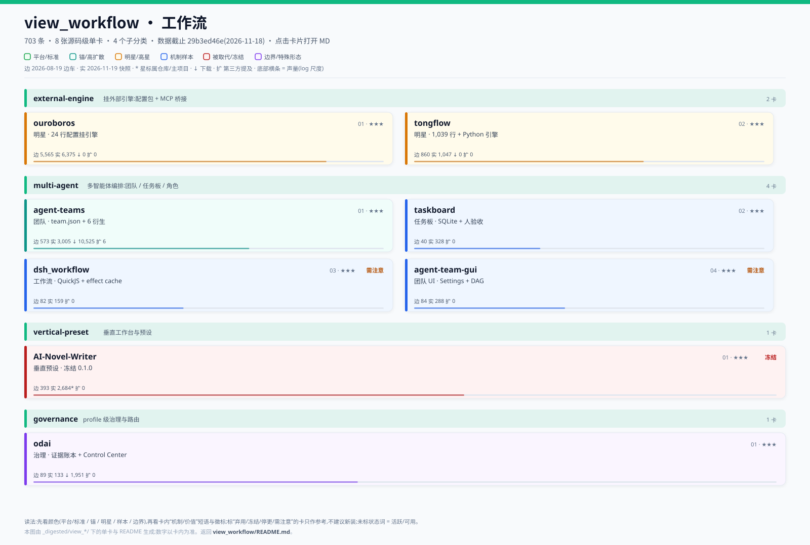

# view_workflow — 工作流

> 已立册(703 条 / 新增 266 / owners 615、单件 91%)。⚠ 星标为历史采样。数据截止 `29b3ed46e`。

**状态优先**:`AI-Novel-Writer` 已冻结(0.1.0、6 个 peer 不存在),不建议新装;`dsh_workflow`(main 停更)与 `agent-team-gui`(钉 0.1.5.x)需改造后使用。其余 5 张可用;真正有衍生的仍是 agent-teams。

**怎么读这张图**:8 张卡按子分类排列;颜色是**角色/价值型**,不是质量排名。`边`/`实`/`*`/`↓`/`扩` 见卡内日期;横条只是声量 log 尺度。`AI-Novel-Writer` 标 **冻结**、`dsh_workflow`/`agent-team-gui` 标 **需注意**,都只作参考;`odai` 的治理是 profile 运行时,不是任务编排。未标状态词 = 活跃/可用。

## 快照

第四大类,本期占比 +0.4pp 匀速。新 owner 榜中 Daphne999(workflow×3)、Delthin(workflow×3)以 workflow 为主落点。

## 锚(存量头部,⚠ 星标历史采样)

| 条目 | 星标 | 说明 |
|------|------|------|
| Q00/ouroboros#integrations/dsh-plugin | 5565 | 全表社区星标第三;纯配置包,零第三方提及([01](external-engine/01-ouroboros.md) ★★★) |
| tong-io/tongflow | 860 | 第二梯队唯一 500+;1 039 行 DSH 适配 + 内联 Studio,引擎在 Python 侧([02](external-engine/02-tongflow.md) ★★★) |
| NanmiCoder/dsh-agent-teams | 573 | 多 agent 编排;6 条真衍生接的是配置行/团队文件,不是调度协议([01](multi-agent/01-agent-teams.md) ★★★) |
| EthanYoQ/AI-Novel-Writer#dsh-ai-novel-writer | 393 | 垂直场景(长文写作);星标属主应用,插件 0.1.0 已冻结([01](vertical-preset/01-ai-novel-writer.md) ★★★) |
| orziz/odai#odai-dsh-plugin | 89 | profile 级治理:职责状态机 + JSONL 证据账本 + Web Control Center([01](governance/01-odai.md) ★★★) |

## 子分类(册内目录)

| 子分类 | 定义 | 成员数(已确认) |
|--------|------|----------------|
| [external-engine](external-engine/README.md) | 挂外部引擎:配置包 + MCP 桥接 | 3 例,第三方提及全为 0 |
| [multi-agent](multi-agent/README.md) | 多智能体编排:团队、任务板、角色 | 5 例 |
| [vertical-preset](vertical-preset/README.md) | 垂直工作台与预设 | 2 例 |
| [governance](governance/README.md) | profile 级治理与路由:准入、证据、验收 | 1 例 |

单卡落在子分类目录内:`<子分类>/NN-<slug>.md`;本册已有 8 张单卡(external-engine 2、multi-agent 4、vertical-preset 1、governance 1),全部 ★★★。

## 稳定性判读

**头部断层最大、但"一超"不是锚**:ouroboros(5565)是第二名的 6.5 倍,读源码后判定为**明星而非锚**——它是纯配置包,24 行有效配置挂在外部引擎上,全表零第三方提及(机制见 [external-engine/01](external-engine/01-ouroboros.md))。所以 workflow 的真实格局是**"明星在前、标准缺位"**:没有谁被同行模仿成惯例。

**八张单卡读完后,这个判断更硬,也更具体**:

- **两个最大声量都不是插件自己的**:ouroboros 的星标属于支持 15 个 runtime 的引擎,tongflow 的星标属于影视生产工具(DSH 子包首提交距采样点 ≤1 天);两者的 DSH 适配层都没有第三方提及。
- **唯一有真衍生的方向是 multi-agent,但衍生接的不是协议**:agent-teams 的多条真衍生里,多数直接读写它的配置行或磁盘 `team.json`,没有一条复用它的 `attemptId` 代次、停放或冷恢复语义;它本身也没有把任务板注册成宿主级 service。
- **任务板没有收敛成标准**:taskboard 的同 token 条目里没有真衍生,数个互不署名的独立实现在 `taskboard_*` 前缀与"agent 不能做人验收的那一步"上趋同,存储、列数、驱动方式全不同。
- **"可恢复"也有两种含义**:dsh_workflow 的 workflow 是 QuickJS 程序而不是 DAG,`resume` 靠内容寻址的 effect cache 回放已完成的 task,不是整条 run 的检查点;它的 main 停在 0.1.2(而 tag 到 0.1.4),0.2.x 的只读路径还会在第一个子 agent 前 fail-closed。
- **团队可以是 UI 资产**:agent-team-gui 的小队存在 Settings 里,派工按有界 DAG、Run Center 展示逐成员 token;它没有把团队暴露成协议,扩散同样为 0,21 个 peer 还全钉在 0.1.5.x。
- **治理可以是 profile 运行时**:odai 把"事/实/法/成/界"注入 8 个 systemPrompt section,用 `pending→active` 职责状态机和按 session 哈希命名的 JSONL 证据账本约束执行;包内 runtime 13,942 行,`dsh/plugin` 只是壳。⚠89 星属 odai 仓库、1,951 下载才是该包的采用信号;registry 自述的 0.1.5-rc.1 已过期,当前包 pin 0.2.2-rc.1。
- **垂直预设的声量属于主应用**:AI-Novel-Writer 的 393 ⚠ 星(实时读数更高)属于小说应用,插件 0.1.0 冻结且 20 个 peer 中 6 个在当前 DSH 上已不存在。

**结论**:workflow 仍是"明星在前、标准缺位",但"最接近锚"的位置从星标榜移到了 **agent-teams**——它有真实衍生,却只开放文件格式与配置,不开放调度协议。下一轮若有人复用它的事件/状态机,才谈得上标准。
